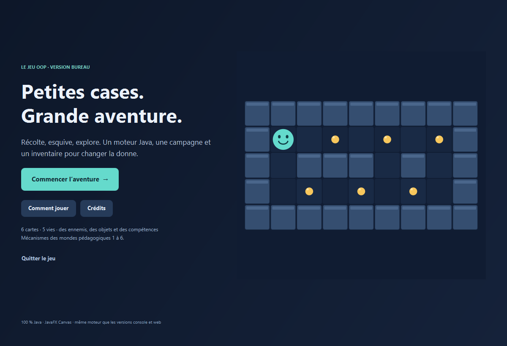
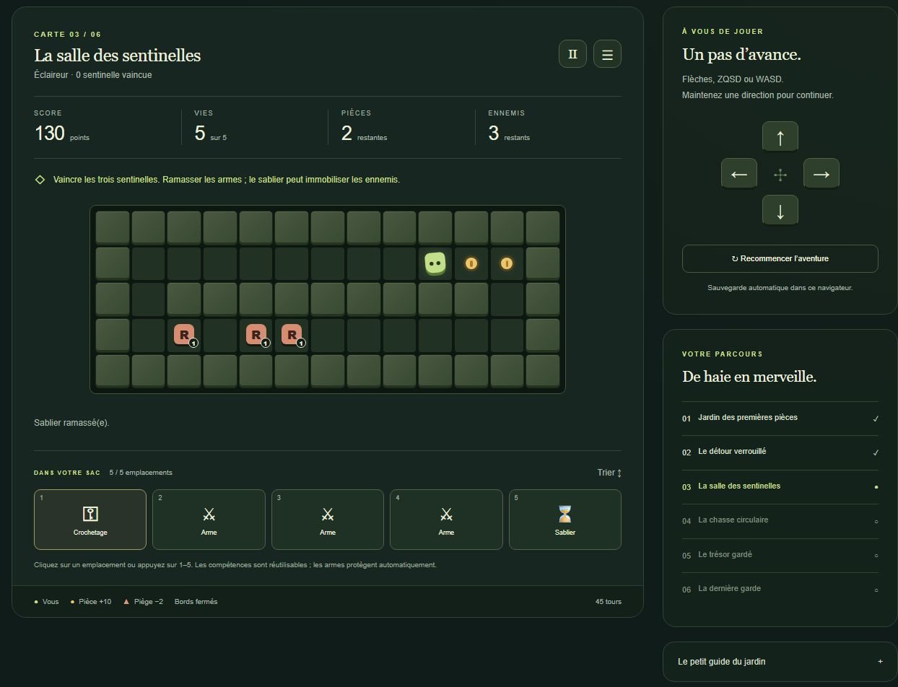
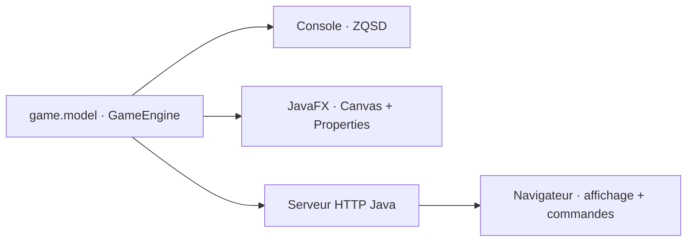

<div align="center">

# 🌿 Les Jardins oubliés

**Six cartes. Trois façons de jouer. Un seul moteur Java.**

Un jeu de labyrinthe issu d’un projet de programmation orientée objet : ramasser, explorer, déjouer les ennemis et choisir le bon objet au bon moment.


[**▶ Jouer dans le navigateur**](https://khayem-oop-game.vercel.app/) · [**↓ Télécharger pour Windows**](https://github.com/khayem487/oop-game-java/releases/latest/download/OOP-Game-Windows.zip) · [**Code source**](https://github.com/khayem487/oop-game-java) · [**Couverture du sujet**](docs/ASSIGNMENT-COVERAGE.md)

</div>

---



*L’écran d’accueil de l’application JavaFX. La grille est dessinée par Canvas.*

<details>
<summary><strong>Voir la version jouable dans le navigateur</strong></summary>



</details>

## Une aventure à terminer

Le jardin commence tranquillement, puis les portes, les sentinelles et les chasseurs changent la manière de jouer. Le score, les vies et l’inventaire vous accompagnent d’une carte à l’autre.

| | Ce qui vous attend |
| --- | --- |
| 🪙 Explorer | Pièces à 10 points, murs, pièges consommés et passages verrouillés. |
| 👻 Observer | Sentinelles aléatoires, fantômes traversant les obstacles et chasseurs à trois vies suivant le plus court chemin. |
| 🎒 Choisir | Cinq places d’inventaire : armes automatiques, sabliers, crochetage et téléportation réutilisable. |
| ↔ Traverser | Une carte torique dont les bords opposés se rejoignent. |
| 🏆 Réussir | Trois types d’objectifs : toutes les pièces, tous les ennemis ou un trophée. |
| 🎲 Rejouer | Une graine fixe reproduit les mêmes événements et permet de vérifier une partie. |

La campagne contient **six cartes jouables**. Les **six mondes du cours** sont les étapes pédagogiques qui ont servi à construire les mécanismes : ils ne désignent pas six niveaux du jeu. Le [tableau de couverture](docs/ASSIGNMENT-COVERAGE.md) relie chaque partie du sujet au code et aux tests.

| Carte | Objectif | Particularité |
| --- | --- | --- |
| 01 · Le jardin des premières pièces | Récupérer six pièces | Découvrir les déplacements et le score. |
| 02 · Le détour verrouillé | Récupérer toutes les pièces | Obtenir le crochetage et traverser la porte. |
| 03 · La salle des sentinelles | Vaincre trois sentinelles | Collecter des armes et utiliser le sablier. |
| 04 · La chasse circulaire | Récupérer trois pièces | Bords reliés, fantôme et chasseur. |
| 05 · Le trésor gardé | Récupérer le trophée | Choisir une route ou exploiter la téléportation. |
| 06 · La dernière garde | Vaincre les trois gardiens | Gérer les armes nécessaires aux trois vies du chasseur. |

## Jouer sur Windows

L’archive [**OOP-Game-Windows.zip**](https://github.com/khayem487/oop-game-java/releases/latest/download/OOP-Game-Windows.zip) contient Java et JavaFX dans son propre dossier ; aucune installation système n’est nécessaire. Les sources de la version publiée sont également disponibles dans les [téléchargements GitHub](https://github.com/khayem487/oop-game-java/releases/tag/v2.0.0).

1. Extraire **tout** le dossier `OOP-Game` de l’archive.
2. Double-cliquer sur **`Jouer.cmd`**.
3. Choisir son nom et sa graine, puis lancer la campagne.

En cas de problème de démarrage, `Diagnostiquer.cmd` affiche les messages de Java. Cette distribution cible **Windows x64** ; les dépendances natives JavaFX sont propres à cette plateforme. Les archives sont générées dans `dist/` et ne sont pas stockées dans Git. La commande pour en construire une est indiquée ci-dessous.

Les chemins avec des espaces et des accents français ont été vérifiés. Si le lanceur indique qu’il ne trouve pas `java.dll` dans un chemin contenant d’autres caractères Unicode, extraire l’archive dans un dossier simple, par exemple `Downloads/OOP-Game`.

## Trois interfaces, les mêmes règles



Le modèle Java calcule les collisions, les points, les dégâts, les déplacements des ennemis, les objets et les objectifs. La console, JavaFX et le navigateur lui envoient des commandes. Le JavaScript du site affiche la réponse ; il ne recode pas les règles du jeu.

L’interface JavaFX suit une architecture **Présentation–Abstraction–Contrôle** : `GamePresentation` et `BoardCanvas` dessinent la scène, `GameController` coordonne les entrées et `GameEngine` porte les règles. `GameState` expose les propriétés observables utilisées par le HUD.

| Action | JavaFX | Navigateur | Console |
| --- | --- | --- | --- |
| Direction | Flèches, ZQSD ou WASD | Flèches, ZQSD, WASD ou boutons tactiles | ZQSD puis Entrée |
| Utiliser un élément | Clic ou touches 1–5 | Clic ou touches 1–5 | 1–5 puis Entrée |
| Trier | T ou bouton | Bouton Trier | `tri` |
| Pause | Espace, P ou Échap | Échap ou bouton | Chaque commande est un tour |
| Suite / recommencer | Boutons, N / R | Boutons | Enchaînement automatique, choix après défaite |
| Aide | F1 ou bouton | Bouton | `aide` |

En JavaFX, une direction lance un déplacement continu toutes les **240 ms** via `AnimationTimer`. La perte de focus met la partie en pause. Sur le site, maintenir une direction répète les commandes ; relâcher la touche ou le bouton arrête ce mouvement.

Une tentative contre un mur consomme aussi un tour et laisse les ennemis agir. Un sablier immobilise les ennemis pendant dix tentatives de déplacement, sans supprimer les collisions si vous marchez directement sur eux. L’arme et le crochetage agissent automatiquement ; le sablier et la téléportation s’activent depuis l’inventaire.

## Développer et lancer

**Prérequis pour compiler : JDK 21**, avec `java`, `javac` et `jar` dans le `PATH`. Le Maven Wrapper est inclus ; il télécharge Maven et les dépendances au premier lancement. Les exemples suivants utilisent PowerShell depuis la racine du dépôt. Sur Linux/macOS, remplacer `.\mvnw.cmd` par `./mvnw` après avoir rendu le script exécutable.

### JavaFX

```powershell
.\mvnw.cmd -Pdesktop package
.\mvnw.cmd -Pdesktop javafx:run
```

Le profil `desktop` ajoute JavaFX, compile les contrôleurs et exécute leurs tests. Pour créer l’archive Windows autonome, avec **Python 3** et `jlink` fourni par le JDK :

```powershell
python scripts/package-desktop.py
```

Le résultat est `dist/OOP-Game-Windows.zip`. Le script construit le paquet Maven, assemble un runtime privé et vérifie l’intégrité de l’archive. Après un `package` déjà vérifié, `--skip-build` évite de relancer cette compilation.

### Console

```powershell
.\mvnw.cmd package
java -jar target/oop-game-2.0.0.jar --campaign --name=Explorateur --seed=20261022
```

Pour jouer ses propres fichiers :

```powershell
java -jar target/oop-game-2.0.0.jar --name=Explorateur niveau1.txt niveau2.txt
```

Sans argument, le programme affiche son utilisation. Les erreurs de fichier ou de carte produisent un message explicite. Le nom est demandé si `--name` est absent.

### Web en local

```powershell
.\mvnw.cmd package
java --add-modules jdk.httpserver -jar target/oop-game-2.0.0-web.jar 8080
```

Ouvrir [localhost:8080](http://localhost:8080). Aucun compte, secret, service tiers ou base de données n’est nécessaire.

<details>
<summary><strong>Compiler la console et le serveur avec le JDK uniquement</strong></summary>

Les scripts Python utilisent seulement la bibliothèque standard. Ils appellent directement `javac` et `jar` ; aucun Maven, JavaFX, JUnit ou paquet Node n’est téléchargé pour ces deux éditions.

```powershell
python scripts/build-cli.py
java -jar .build/game-console.jar --campaign

python scripts/build-web.py
java --add-modules jdk.httpserver -jar .build/game.jar 8080
```

Ces compilations ne remplacent pas la suite de tests Maven et ne construisent pas l’interface JavaFX.

</details>

<details>
<summary><strong>Format d’une carte personnalisée</strong></summary>

Un fichier texte UTF-8 contient une grille rectangulaire et exactement un joueur `1`. Les espaces représentent le sol ; conserver les espaces en fin de ligne si la carte en utilise. Exemple :

```text
;name=Le petit passage
;objective=Ramasser toutes les pièces
;toroidal=false
;goal=coins
#######
#1 . .#
#######
```

Symboles : `#` mur, `.` pièce, `*` piège, `D` porte, `R` sentinelle, `G` fantôme, `C` chasseur, `W` arme, `H` sablier, `T` trophée. Les objectifs acceptés sont `coins`, `enemies` et `trophy`. Sans en-tête, une carte utilise l’objectif pièces et la topologie torique. Les fichiers personnalisés se chargent par la console ; le site public ne propose pas d’import de fichiers.

</details>

## Vérifier le projet

```powershell
# Modèle, cartes, console et serveur HTTP
.\mvnw.cmd test

# Inclut les tests du contrôleur JavaFX
.\mvnw.cmd -Pdesktop test

# Javadoc : target/reports/apidocs/index.html
.\mvnw.cmd javadoc:javadoc

# Partie entière via la vraie API HTTP, avec un serveur local temporaire
python scripts/build-web.py
python scripts/test-web.py

# Même contrôle sur le déploiement publié
python scripts/test-web.py https://khayem-oop-game.vercel.app

# Régression des touches maintenues, pause et dialogues (Node.js)
node --test scripts/test-web-input.cjs
```

La vérification du **23 octobre 2026** compte **81 tests JUnit réussis**, profil JavaFX inclus, sans échec ni test ignoré. Les tests couvrent les limites du score, la validation des cartes, le tore, le BFS du chasseur, les collisions multiples, l’inventaire plein, les seuils des compétences, la pause et les propriétés du HUD, ainsi que la validation et l’isolation de l’API.

Deux parties reproductibles terminent les six cartes avec **180 points, cinq vies et six ennemis vaincus**, pour les graines `20261022` et `1337`. Leurs **90 et 91 commandes** figurent dans [`scripts/campaign-solution.json`](scripts/campaign-solution.json), avec les checkpoints de chaque carte. Ces solutions passent par les commandes publiques normales, sans modifier le score ou les vies depuis les tests.

Les tests du contrôleur ne suffisent pas à vérifier le rendu graphique. Les sondes `DesktopSnapshotProbe` et `DesktopDialogProbe`, dans `desktop/src/test`, permettent aussi d’exercer de vraies scènes et boîtes de dialogue JavaFX ; elles nécessitent une session graphique et s’exécutent séparément de JUnit. Leur code vérifie notamment le clavier, les boutons d’inventaire, le HUD, les menus, les dialogues et les états de fin.

## Sauvegarde et hébergement

Le navigateur conserve localement **le nom, la graine et l’historique des commandes**, puis le serveur Java reconstruit la partie à chaque requête. Deux visiteurs restent indépendants ; aucun score, position ou nombre de vies fourni par le client n’est accepté. Une nouvelle instance serveur peut donc reprendre la partie à partir du navigateur. Les anciennes sauvegardes v1 sont retirées avec un message de migration.

La sauvegarde reste liée à ce navigateur et peut disparaître si son stockage est effacé. Les versions console et JavaFX ne sauvegardent pas une partie à la fermeture. Le jeu est solo, sans compte ni classement partagé.

Le site utilise `Dockerfile.vercel` et le service Java déclaré dans `vercel.json`. **La publication Vercel de ce dépôt est manuelle**, via la CLI authentifiée : un push GitHub seul ne met pas cette démo à jour. L’intégration Git automatique autorisée pour d’autres projets du portfolio ne couvre pas ce dépôt. Les délais de démarrage et quotas dépendent de Vercel ; le serveur n’est pas annoncé comme constamment actif.

<details>
<summary><strong>API HTTP v2</strong></summary>

- `GET /api/health` : état du serveur, moteur `shared-java`, version 2 et six cartes.
- `POST /api/game` : formulaire `application/x-www-form-urlencoded`, champs `name`, `seed`, `history`, `command`.
- Commandes : `STATE`, `RESTART`, `UP`, `LEFT`, `DOWN`, `RIGHT`, `NEXT`, `USE_1` à `USE_5`, `SORT`.
- Historique : `U/L/D/R/N`, `1`–`5` pour l’inventaire et `S` pour le tri ; au plus **2 048 commandes** et **4 096 octets** par requête.
- Réponse : terrain, positions et vies des ennemis, inventaire, objectifs, état, score, vies, tours et historique canonique. Le serveur valide aussi le nom et une graine positive.
- Les entrées inconnues, états injectés et historiques impossibles sont rejetés. Les méthodes, types de contenu et origines de navigateur sont contrôlés ; les ressources sont servies avec une politique CSP stricte.

</details>

## Organisation du dépôt

```text
src/main/java/game/model/    Moteur et objets du jeu
src/main/java/game/cli/      Interface console
src/test/java/              Tests du modèle et de la console
desktop/src/main/           Interface JavaFX, Canvas et styles
desktop/src/test/           Tests et sondes graphiques JavaFX
web/src/                    Serveur HTTP et sérialisation JSON
web/public/                 Interface du navigateur
web/tests/                  Tests HTTP Java
scripts/                    Builds, ZIP Windows et vérification HTTP
docs/ASSIGNMENT-COVERAGE.md  Correspondance sujet → code → preuves
legacy/                     Ancien moteur et première adaptation web
world1_send/, world2_send/   Étapes historiques du cours
```

Cette version complète et restructure le travail initial avec une assistance de programmation. Les étapes historiques sont conservées hors des sources compilées. La couverture technique documentée ne vaut pas validation par l’enseignant ; la grille Excel et les éventuelles consignes Teams supplémentaires ne sont pas disponibles ici.
